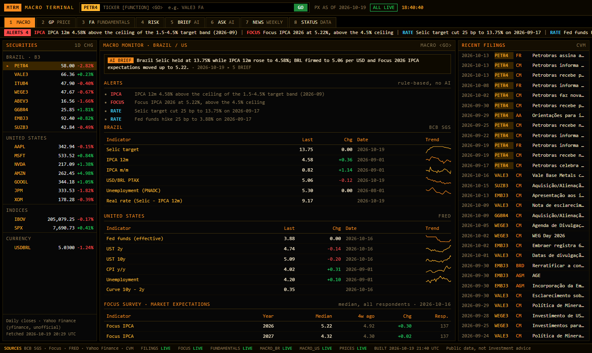

# Macro Terminal

**[See it working](https://gcabralcavalcanti.github.io/macro-terminal/)** · [Overview, 1 page (PDF)](overview.pdf)

A one-page dashboard, styled like a trading terminal, that shows where the Brazilian and US economies and markets
stand today, flags what changed, and has an AI write a short summary that is checked against the data.
The plan is for it to become the central panel of my day: alongside markets, the news I turn into study cards,
job openings and my goals, in a private version. This repository is the public, markets part.




## What it shows

- Interest rates, inflation, the dollar and unemployment for Brazil and the US, with what economists expect for this
  year and next, plus prices, risk and company results for large Brazilian and US stocks.
- Alerts when something important changes, such as inflation leaving the official target band, and a check on every
  download so a broken source never shows wrong numbers.
- A summary and answers to questions written by Claude, where every number is confirmed against the data
  ([example](docs/screenshots/brief.png)).

## Run it

```bash
pip install -r requirements.txt
python demo.py
```

Runs without an API key, replaying recorded answers. Set `ANTHROPIC_API_KEY` to call Claude live.

## More

- [How I use it and how it works](docs/how-it-works.md): what runs on its own, the steps, the checks, the data
  sources and the command line.
- [Runbook](RUNBOOK.md): updating, publishing, automation and what to do when something breaks.

## Limits

- Daily closing prices, not real time.
- Company results cover Brazilian non-financial companies only.
- The check catches made-up numbers, not a wrong reading of real ones. Not investment advice.

## How AI was used

I use Claude (Claude Code and the API) for coding, review and documentation. The questions, modelling choices,
validation and conclusions are mine.

MIT License.
