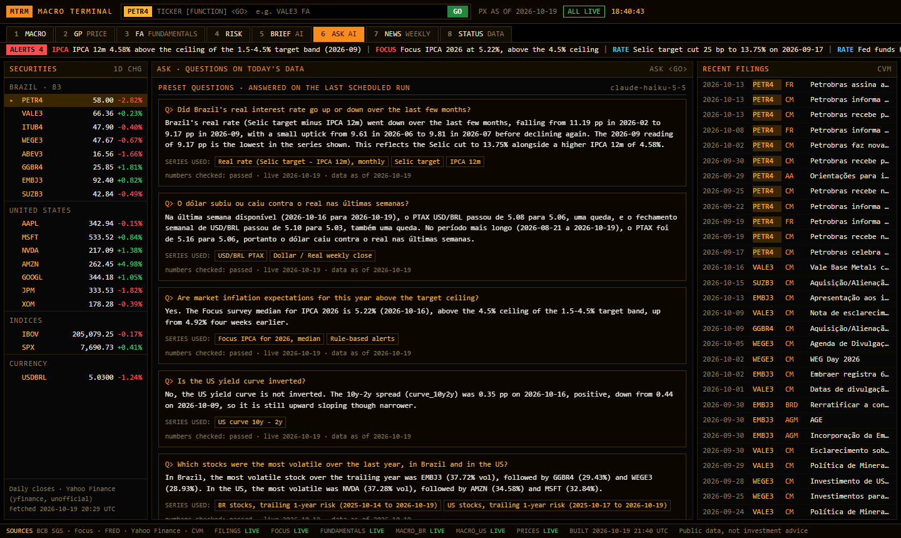
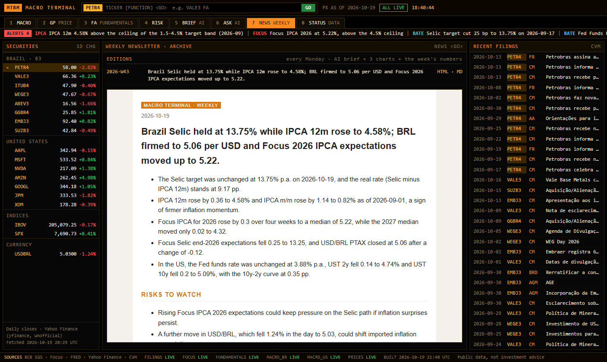

# Macro Terminal

A terminal-style dashboard of Brazilian and US macro and market data, built only from public sources.
Python collects and checks the data, raises rule-based alerts and writes a static page (no server). The Claude API
writes a short brief from the day's numbers and answers questions about them, citing the series it used.
GitHub Actions refreshes and publishes it.

**Live:** https://gcabralcavalcanti.github.io/macro-terminal/


| Price, moving averages and volume | Quarterly fundamentals (CVM filings) |
|---|---|
|  |  |
| **Risk: volatility, beta, drawdown, Sharpe, correlation** | **AI brief (checked against the input numbers)** |
|  |  |
| **Ask: questions answered from the data, with the series cited** | **Weekly newsletter (Markdown + HTML, 3 charts)** |
|  |  |

Also: a data status tab (every check, every source, live or stale) and a phone layout ([screenshot](docs/screenshots/mobile.png)).

## What it shows

| Tab | Content | Source |
|---|---|---|
| 1 MACRO | Selic target, IPCA (12m and m/m), USD/BRL PTAX, unemployment, real rate; fed funds, 2y/10y Treasuries, curve, CPI y/y, unemployment; Focus survey medians and 4-week change | BCB SGS, BCB Focus (Olinda), FRED |
| 2 GP | Daily close with 20/50/200-day moving averages, volume, 52-week range | Yahoo Finance (yfinance) |
| 3 FA | Revenue, gross profit, EBIT, net income and margins, last 8 quarters | CVM open data (ITR/DFP) |
| 4 RISK | Annualised volatility, beta to the local index, max drawdown, Sharpe (risk-free = Selic or fed funds), correlation heatmap | computed from prices |
| 5 BRIEF | Headline, 3–5 points, risks, data caveats | Claude API |
| 6 ASK | Questions in plain language (English or Portuguese) answered from the day's data, with the series used | Claude API |
| 7 NEWS | Weekly editions: brief, alerts, 3 charts, the week's numbers; archive of past editions | generated |
| 8 STATUS | Each dataset: live / stale / missing, last observation, checks that fired | the pipeline itself |
| top bar | Alerts: policy rate changed, IPCA 12m or Focus IPCA outside the 1.5–4.5% target band, FX or index move of 2%+, stock move of 5%+, stale source | rules in `alerts.py`, no AI |
| right panel | Recent filings: material facts, market notices, results, meetings | CVM open data (IPE) |

Universe: 8 Brazilian stocks, 7 US stocks, Ibovespa, S&P 500 and USD/BRL (edit `macro_terminal/config.py`).
Keyboard: `1`–`8` switch tabs, arrows move through the list, type `VALE3 FA` and Enter in the command line.
Links like `index.html#risk/AAPL` open a tab and security directly.

## How it works

```
collect -> checks -> cache -> analytics + alerts -> brief, ask (Claude) -> newsletter -> build (site/) -> Pages
```

- **Checks on every download** (`checks.py`): missing values per series (over 20% rejects), unreadable, duplicated or
  future dates (the Selic target series is published up to the next meeting), staleness by frequency, plausible range
  per series to catch unit changes (Selic 0–60% p.a., USD/BRL 1–15...), non-positive prices, daily moves above 40%,
  revenue scale (catches thousands vs units).
- **A failing source never breaks the page.** Network error or failed check: the last good copy stays, the dataset is
  marked STALE on screen with the error. A ticker missing from today's download keeps its cached history.
- **Alerts** (`alerts.py`) are plain rules, each shown with the rule that fired: no model involved.
- **Static page:** the data goes into `site/data.js` (`window.TERMINAL = {...}`), so `site/index.html` opens straight
  from disk. Plain HTML/CSS/JS and canvas charts, no libraries, no external requests.
- **Fundamentals:** the CVM zips are read without extracting; Q4 is not filed as a quarter, so Q4 = annual (DFP) minus
  nine months year-to-date (ITR Q3). The zips (~100 MB) are refreshed weekly.

## The AI brief

The code picks and computes every number; the model only writes about them (`brief.py`).

| Concern | What the code does |
|---|---|
| Format | JSON Schema through structured outputs; validated again locally with stricter rules (3–5 points, lengths) |
| Hallucinated numbers | every number in the text must exist in the input data (rounding allowed, decimal comma read); otherwise one retry with the error, then stop |
| Cost | `claude-haiku-5-5`, `max_tokens` 700, at most 2 calls per run; a brief is ~2,400 input and ~550 output tokens, about US$ 0.0005 |
| Repeats | every accepted answer is recorded in `recordings/`; the same input is never paid twice |
| No key / API down | the latest recorded brief is shown, labelled with its date |
| Reliability | 45 s timeout, SDK retries for network/429/5xx, one JSON log line per call (`logs/`, tokens and cost) |
| Secrets | `ANTHROPIC_API_KEY` from the environment or `.env` (never committed) |

## Ask

`ask.py` builds a small JSON context from the cache (recent weekly or monthly points of each series, Focus medians,
risk table, alerts), each series with an id. The answer schema allows only those ids in `series_used` (a closed
list), the same number check as the brief applies, and an answer with no citation is rejected (one retry, then dropped).

- Public page: 5 preset questions answered on the scheduled run (about US$ 0.003 for the five).
- Live questions: `python -m macro_terminal ask "did the real rate go up this month?"`, or
  `python -m macro_terminal serve` (127.0.0.1 only, so the key never leaves the machine; 20 questions per session),
  which adds a question box to the ASK tab. About US$ 0.0006 per question. Live answers are cached outside the repository.

## Newsletter

`python -m macro_terminal newsletter` writes `newsletter/2026-W43.md` and `.html`: the latest brief, the alerts,
three SVG charts (Selic vs IPCA 12m, USD/BRL, Ibovespa vs S&P 500 rebased) and the week's numbers. No extra API call;
the NEWS tab lists past editions.

## Run it

```bash
pip install -r requirements.txt
python -m macro_terminal all            # collect + brief + ask + newsletter + build
python -m macro_terminal all --demo     # same, never calls the API
python -m pytest -q                     # 29 tests, no network
```

Then open `site/index.html`. Steps can run alone: `collect [--only prices,filings]`, `brief`, `ask`, `newsletter`,
`build`, `serve`.

## Scheduled run (GitHub Actions)

`.github/workflows/update.yml` runs on weekdays at 22:30 UTC: tests, collect, brief and ask (Mondays), newsletter,
build, deploy to Pages.

- Pages: *Settings > Pages > Source: GitHub Actions*.
- Key: *Settings > Secrets and variables > Actions > New repository secret*, name `ANTHROPIC_API_KEY`.
  Without it the workflow still runs and shows the latest recorded answers.
- The AI calls run on Mondays (or on a manual run). Set the repository variable `AI_DAILY=true` for every weekday.
  Measured cost of a Monday run: brief about US$ 0.0005 + five preset questions about US$ 0.003.
- `actions/cache` keeps the last good data, the newsletter archive and the CVM zips between runs; the committed
  `data/cache` is the fallback.

## Layout

```
macro_terminal/   collect.py, checks.py, cache.py, analytics.py, alerts.py, brief.py, ask.py, llm.py,
                  newsletter.py, build.py, serve.py
  sources/        bcb.py (SGS, Focus), fred.py, market.py (yfinance), cvm.py (ITR/DFP, IPE)
web/              page template: index.html, terminal.css, terminal.js
site/             generated page (what Pages serves)
data/cache/       last good copy of each dataset + _status.json
schemas/          brief.api.json (sent to the API), brief.strict.json (local validation)
newsletter/       weekly editions (Markdown, HTML, SVG charts)
recordings/       recorded AI answers        tests/  fixtures and a fake API client
```

## Limits

- Yahoo Finance is unofficial and can change or throttle; it is the first source to show STALE.
- Fundamentals cover Brazilian non-financial companies (banks file a different income statement).
- Beta and correlation use each market's own calendar; FX trades on days the B3 is closed.
- The number check catches invented numbers, not a wrong reading of real ones.
- Prices are daily closes, not real time. Not investment advice.

The BCB, FRED and CVM download code is adapted from the author's thesis data pipeline (DCF valuation of Gerdau).

MIT License.
