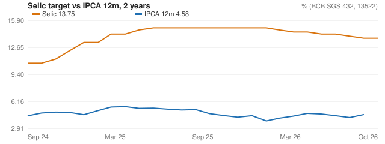
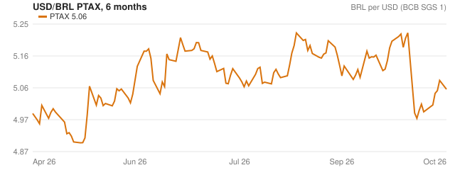
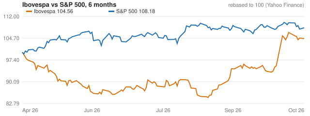

# Macro Terminal weekly · 2026-10-19

**Brazil Selic held at 13.75% while IPCA 12m rose to 4.58%; BRL firmed to 5.06 per USD and Focus 2026 IPCA expectations moved up to 5.22.**

- The Selic target was unchanged at 13.75% p.a. on 2026-10-19, and the real rate (Selic minus IPCA 12m) stands at 9.17 pp.
- IPCA 12m rose by 0.36 to 4.58% and IPCA m/m rose by 1.14 to 0.82% as of 2026-09-01, a sign of firmer inflation momentum.
- Focus IPCA for 2026 rose by 0.3 over four weeks to a median of 5.22, while the 2027 median moved only 0.02 to 4.32.
- Focus Selic end-2026 expectations fell 0.25 to 13.25, and USD/BRL PTAX closed at 5.06 after a change of -0.12.
- In the US, the Fed funds rate was unchanged at 3.88% p.a., UST 2y fell 0.14 to 4.74% and UST 10y fell 0.2 to 5.09%, with the 10y-2y curve at 0.35 pp.

**Risks to watch**

- Rising Focus IPCA 2026 expectations could keep pressure on the Selic path if inflation surprises persist.
- A further move in USD/BRL, which fell 1.24% in the day to 5.03, could shift imported inflation expectations.
- US CPI y/y rose by 0.31 to 4.02% while the Fed funds rate was held at 3.88%, leaving room for rate expectations to shift.

**Alerts**

- IPCA 12m 4.58% above the ceiling of the 1.5-4.5% target band (2026-09)
- Focus IPCA 2026 at 5.22%, above the 4.5% ceiling
- Selic target cut 25 bp to 13.75% on 2026-09-17
- Fed funds hike 25 bp to 3.88% on 2026-09-17

## Charts

## Brazil

| Indicator | Last | Change | Date |
| --- | --- | --- | --- |
| Selic target | 13.75 | 0.0 | 2026-10-19 |
| IPCA 12m | 4.58 | 0.36 | 2026-09-01 |
| IPCA m/m | 0.82 | 1.14 | 2026-09-01 |
| USD/BRL PTAX | 5.06 | -0.12 | 2026-10-19 |
| Unemployment (PNADC) | 5.3 | 0.0 | 2026-08-01 |
| Real rate (Selic - IPCA 12m) | 9.17 | — | 2026-10-19 |

## United States

| Indicator | Last | Change | Date |
| --- | --- | --- | --- |
| Fed funds (effective) | 3.88 | 0.0 | 2026-10-16 |
| UST 2y | 4.74 | -0.14 | 2026-10-16 |
| UST 10y | 5.09 | -0.2 | 2026-10-16 |
| CPI y/y | 4.02 | 0.31 | 2026-09-01 |
| Unemployment | 4.2 | 0.1 | 2026-09-01 |
| Curve 10y - 2y | 0.35 | — | 2026-10-16 |

## Markets (last session)

| Ticker | Close | 1D % |
| --- | --- | --- |
| PETR4 | 58.0 | -2.82 |
| VALE3 | 66.36 | 0.23 |
| ITUB4 | 47.9 | -0.4 |
| WEGE3 | 47.67 | -0.67 |
| ABEV3 | 16.56 | -1.66 |
| GGBR4 | 25.85 | 1.81 |
| EMBJ3 | 92.4 | 0.82 |
| SUZB3 | 42.84 | -0.49 |
| AAPL | 342.94 | -0.15 |
| MSFT | 533.52 | 0.84 |
| NVDA | 217.09 | 1.38 |
| AMZN | 262.45 | 4.98 |
| GOOGL | 344.18 | 1.05 |
| JPM | 333.53 | -1.82 |
| XOM | 178.28 | -0.39 |
| IBOV | 205079.25 | -0.17 |
| SPX | 7690.73 | 0.41 |
| USDBRL | 5.03 | -1.24 |

---
Text written by claude-haiku-5-5 from the numbers above; every number in it was checked against the input data. Sources: BCB, FRED, Yahoo Finance, CVM. Not investment advice.
